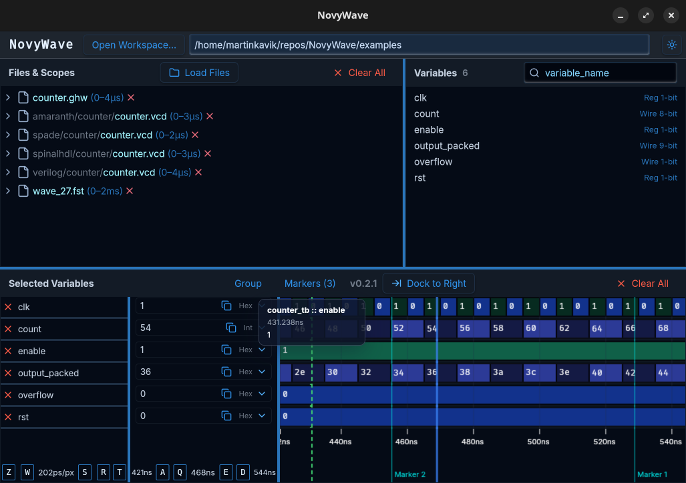
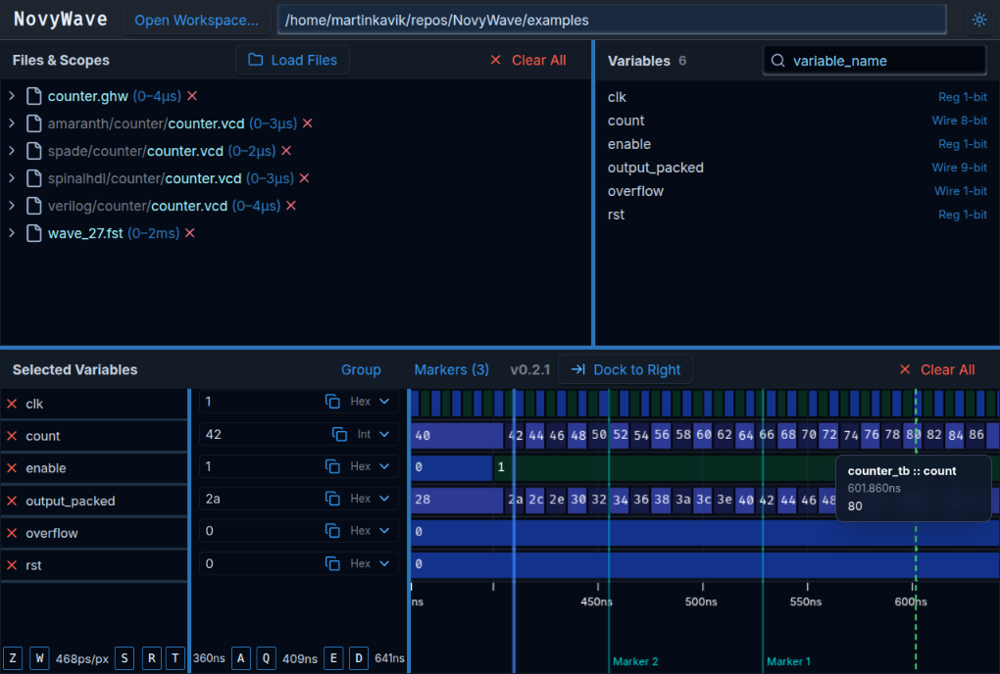
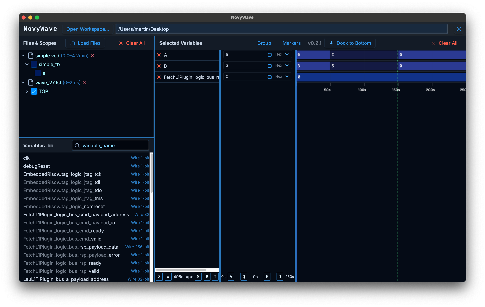
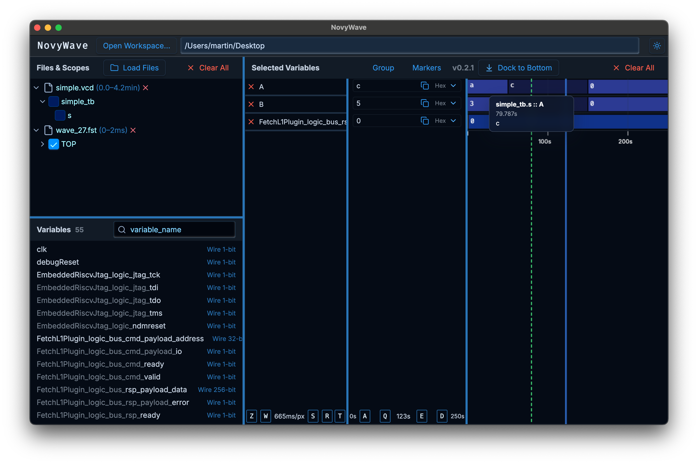
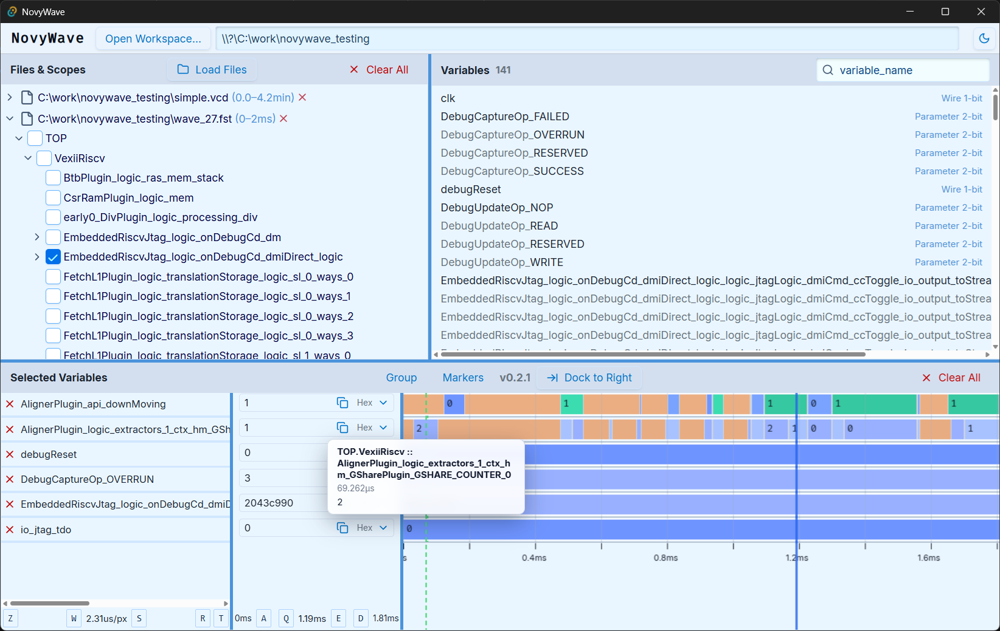

# NovyWave Screenshots

Cross-platform gallery showing NovyWave running on Linux, macOS, and Windows.

## Linux

Linux native WebView, dark theme.

Linux Chrome launcher, dark theme.

## macOS

macOS native WebView, dark theme.

macOS Chrome launcher, dark theme.

## Windows

Windows 11 native WebView, light theme.
